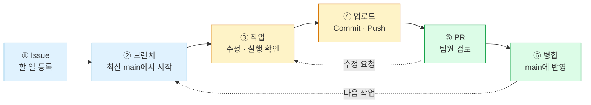

# 🤝 GitHub 협업 가이드

> **매일 보는 내용은 아래 6단계만!** 처음 설정과 오류 해결은 필요한 때 펼쳐 보세요.
>
> 명령어는 Clone한 프로젝트 폴더의 PowerShell / VS Code 터미널에서 실행합니다.

## 🗺️ 한눈에 보는 작업 흐름



| 꼭 지킬 것 ✅ | 피할 것 ❌ |
|---|---|
| 작업 하나마다 새 브랜치 | main에 직접 Push / 직접 편집 |
| 변경 파일 확인 후 Commit | 확인 없이 `git add .` |
| 다른 팀원 검토 후 병합 | 혼자 확인하고 바로 병합 |
| 데이터·API 변경 먼저 공유 | 공용 파일·DB를 말없이 변경 |

## 🚀 매일 사용하는 6단계

### ① 할 일 등록 — Issue

GitHub → **Issues → New issue** → 담당자 지정

| 작성 항목 | 예시 |
|---|---|
| 제목 | `[DATA] 재무제표 수집` |
| 목적 | 분석에 필요한 기업별 재무 데이터 확보 |
| 작업 범위 | 수집 코드와 데이터 형식 문서 |
| 완료 기준 | 샘플 수집 실행 + 컬럼 설명 작성 |

> 기존 Issue를 먼저 확인하세요. 아래 명령의 **12는 예시 Issue 번호**입니다.

### ② 최신 코드 받기 → 작업 브랜치 만들기

먼저 확인합니다.

```powershell
git status
```

**변경 파일이 없다면** 다음을 실행합니다. 변경이 있다면 아래 「문제 해결」을 확인하세요.

```powershell
git switch main
git pull --ff-only origin main
git switch -c feat/12-data-collection
```

| 작업 종류 | 브랜치 예시 |
|---|---|
| 기능 추가 | `feat/12-data-collection` |
| 오류 수정 | `fix/21-api-timeout` |
| 문서 작성 | `docs/15-financial-metrics` |
| 환경 설정 | `chore/23-python-env` |

> **브랜치는 역할별이 아니라 작업별로!** 진행 중인 작업을 이어갈 때는 기존 작업 브랜치로 이동합니다.

### ③ 수정하고 실행 확인

- 기능 변경 → 실제 실행 결과 확인
- 문서 변경 → 명령어·링크·오탈자 확인
- 데이터/API 변경 → 연결되는 담당자와 형식 확인

### ④ 변경 확인 → Commit → Push

아래 파일 경로와 메시지는 **본인이 수정한 파일에 맞게** 바꿉니다.

```powershell
git branch --show-current
git status
git diff
git add docs/financial-metrics.md
git diff --cached
git commit -m "docs: 재무지표 정의 추가"
git push -u origin HEAD
```

| 명령 | 의미 |
|---|---|
| `git branch --show-current` | main이 아닌 내 작업 브랜치인지 확인 |
| `git status` / `git diff` | 파일 목록 / 기존 파일 변경 확인 |
| `git add 파일경로` | 이번에 저장할 파일 선택 |
| `git diff --cached` | 선택한 변경 최종 확인 |
| `git commit` | **내 컴퓨터**에 변경 이력 저장 |
| `git push` | **GitHub**에 업로드 |

> 새 파일 내용은 편집기에서도 확인하세요. 같은 브랜치의 다음 업로드부터는 `git push`만 사용하면 됩니다.

### ⑤ PR 만들기 → 팀원 검토

GitHub → **Pull requests → New pull request**

```text
받을 곳 (base)                 보낼 곳 (compare)
     main          ←          내 작업 브랜치
```

**Files changed 확인 → 설명 작성 → 리뷰어 지정** 순서로 진행합니다.

```markdown
## 목적과 변경 내용
- 왜 필요한지 / 무엇을 바꿨는지

## 확인 결과
- 확인 방법과 실제 결과
- 확인하지 못한 항목과 이유

## 팀원에게 알릴 내용
- 환경·데이터·API 변경 또는 후속 작업

Closes #12
```

| 상황 | 다음 행동 |
|---|---|
| 아직 작업 중 | Draft PR로 공유 |
| 리뷰어가 수정 요청 | **같은 브랜치**에서 수정 → Commit → Push |
| Issue 전체 해결 | `Closes #12`로 연결 |
| Issue 일부만 처리 | `Refs #12`로 참조 |

> Push하면 기존 PR도 갱신됩니다. 수정할 때마다 새 PR을 만들지 않습니다.

### ⑥ 검토 후 병합 → 다음 작업 준비

**권장 팀 규칙:** 작성자 외 1명 승인 + 수정 요청·충돌 해결 + 자동 검사가 있다면 통과

초반에는 **Merge pull request 방식**으로 통일하고, 작성자 또는 정한 담당자가 병합합니다.

병합 후 `git status`로 변경이 없는지 확인하고 실행합니다.

```powershell
git switch main
git pull --ff-only origin main
git branch -d feat/12-data-collection
```

| 정리할 곳 | 방법 |
|---|---|
| GitHub의 작업 브랜치 | PR 병합 후 **Delete branch** |
| 내 컴퓨터의 작업 브랜치 | 위 `git branch -d` |

> 병합 완료와 팀원이 사용 중이지 않음을 확인한 뒤 삭제합니다. `-d`가 거부되면 강제 삭제하지 말고 남은 변경·병합 방식을 확인하세요.

---

## 🔐 업로드 전 반드시 확인

| 항목 | 공유 방법 / 주의점 |
|---|---|
| API 키·비밀번호·DB 접속 정보 | `.env`에 보관. 코드·출력·로그·이미지에도 노출 금지 |
| 환경변수 안내 | `.env.example`에 변수 이름과 **가짜 값**만 작성 |
| 원본 데이터·모델 | 별도 저장 위치 합의. Git에는 출처·버전·생성 방법 기록 |
| 개인정보·DB 전체 덤프 | 업로드 금지. 공개 가능한 작은 샘플 사용 |
| 가상환경·설치 폴더 | `.venv/`, `node_modules/` 대신 의존성 파일 공유 |
| 노트북 | 민감하거나 큰 출력 정리. 같은 파일 동시 편집 피하기 |

> ⚠️ **키가 올라갔다면 즉시 폐기·재발급하고 팀에 알리세요.** 파일 삭제만으로 과거 Commit에서 사라지지 않습니다.
>
> `.gitignore`도 이미 추적 중인 파일을 자동으로 제외하지 않습니다. 현재 규칙은 **모든 CSV·Excel 파일을 막는 규칙이 아닙니다.**

## 🧩 역할과 연결 지점

| 담당 | 주 업무 | 다른 담당자와 맞출 내용 |
|---|---|---|
| 개발 | 데이터 수집·자동화·웹 | 데이터 컬럼, API 요청·응답 |
| 재무제표 | 지표 정의·해석·평가 | 계산식, 금액 단위, 연결/별도·기간 기준 |
| 데이터 분석 | 전처리·EDA·모델·LLM | 데이터 버전, 전처리, 평가 방법 |
| 공통 | 문서·검토·결과 정리 | 실행 방법, 담당자, 완료 기준 |

**같은 파일을 함께 수정할 때는 먼저 범위와 순서를 합의합니다.** 브랜치가 달라도 공용 DB와 외부 API의 실제 상태는 공유됩니다.

---

## 📚 필요할 때 펼쳐 보기

<details>
<summary><strong>처음 참여할 때 — 설치·권한·Clone</strong></summary>

1. Git을 설치하고 터미널을 다시 엽니다. `git --version`으로 확인합니다.
2. 저장소 관리자의 협업 초대를 수락합니다. 이 가이드는 같은 저장소에 Push 권한이 있는 팀 협업 방식입니다.
3. 본인 정보로 Commit 작성자를 설정합니다. 아래 값은 바꿔 입력합니다.

```powershell
git config --global user.name "본인 이름"
git config --global user.email "본인 GitHub 이메일"
```

이메일 공개를 피하려면 GitHub Settings → Emails의 본인 noreply 주소를 사용합니다. `--global`은 다른 저장소에도 적용됩니다. 이 설정은 로그인과 별개입니다.

프로젝트를 둘 상위 폴더에서 실행합니다.

```powershell
git clone https://github.com/KB-Bridge-final-project-team/credict-watch.git
cd credict-watch
git remote -v
git status
```

- origin이 팀 저장소 주소인지 확인합니다. ZIP 다운로드 대신 Clone을 사용합니다.
- 인증은 Git이 안내하는 브라우저 로그인 절차를 따릅니다. 계정 비밀번호를 토큰 대신 입력하지 않습니다.
- 패키지·환경변수는 실행 안내대로 별도 준비합니다. Clone만으로 설치되지는 않습니다.

</details>

<details>
<summary><strong>작업 중 main이 바뀌었을 때 — 최신 변경 반영</strong></summary>

내 작업을 Commit하고 `git status`에서 미저장 변경이 없는지 확인한 뒤 실행합니다.

```powershell
git switch feat/12-data-collection
git fetch origin
git merge origin/main
```

충돌이 없으면 실행 확인 후 `git push`합니다. 병합 메시지 편집기가 열리면 저장하고 닫습니다. 충돌이 생기면 다음 항목을 확인합니다.

</details>

<details>
<summary><strong>충돌이 생겼을 때 — 두 변경 합치기</strong></summary>

```text
충돌 파일 확인 → 담당자와 의도 확인 → 내용 합치기 → 실행 확인 → Push
```

1. `git status`로 충돌 파일을 찾습니다.
2. 아래 표시를 제거하고 필요한 두 변경을 합쳐 저장합니다. Current/Incoming 중 하나를 무조건 선택하지 않습니다.

```text
<<<<<<< HEAD
내 브랜치 내용
=======
main에서 가져온 내용
>>>>>>> origin/main
```

3. 아래 경로를 실제 충돌 파일로 바꿔 병합을 완료합니다.

```powershell
git add docs/financial-metrics.md
git diff --cached
git commit -m "chore: 최신 main 반영 및 충돌 해결"
```

4. 실행을 다시 확인하고 `git push`합니다.

판단이 어려우면 진행 중인 병합에서 `git merge --abort`로 취소하고 담당자와 확인합니다. 병합 전 내 작업이 Commit된 상태를 전제로 합니다.

</details>

<details>
<summary><strong>명령어가 실패했을 때 — 상황별 대응</strong></summary>

| 상황 | 대응 |
|---|---|
| 브랜치 이동 시 덮어쓰기 오류 | 현재 작업 브랜치에서 필요한 변경 Commit 후 이동 |
| `pull --ff-only` 실패 | 로컬/원격 이력 확인. 임의 초기화 금지 |
| Push가 `non-fast-forward`로 거부 | 작업 Commit → fetch → 해당 원격 브랜치 이력·담당자 확인 → 병합 |
| 403 / Permission denied | 로그인 계정, 초대 수락, 쓰기 권한, origin 확인 |
| `nothing to commit` | 파일 저장·status 확인. 제외 여부는 `git check-ignore -v 파일경로` |
| main에서 수정했지만 아직 Commit 전 | `git switch -c fix/새작업이름`으로 새 브랜치 생성 |
| main에 실수로 Commit | Push 중단. 팀과 브랜치 보존·복구 방법 확인 |
| 브랜치 `-d` 삭제 거부 | PR 병합 여부·남은 변경 확인. Squash/Rebase 병합도 원인일 수 있음 |

질문할 때 **실행한 명령 + 오류 전문 + 현재 브랜치 + `git status`**를 공유합니다. 비밀정보는 가립니다.

`push --force`, `reset --hard`, `clean -fd`, `branch -D`는 이력·파일·브랜치를 없앨 수 있습니다. 오류 해결용으로 무작정 실행하지 않습니다.

</details>

<details>
<summary><strong>프로젝트 폴더와 문서 관리</strong></summary>

2026-10-13 확인한 최상위 구조입니다.

```text
credict-watch/
├── data_pipeline/   # 수집·자동화
├── frontend/        # 웹페이지
├── analysis/        # 전처리·분석
├── docs/            # 프로젝트 문서
├── .gitignore
└── CONTRIBUTING.md
```

- `models/`, `finance/`, `README.md`는 확인 시점에 없으며, 필요하면 용도를 합의해 추가합니다.
- 실행 안내는 README에, 데이터·API·재무지표 합의는 `docs/`에 기록하는 것을 권장합니다.
- 재현을 위해 데이터 출처·버전, 전처리 순서, 학습/평가 분리, 난수 시드, 평가 지표를 기록합니다.
- 현재 `.gitignore`는 `data/raw/`, `*.pkl`, `*.joblib`, `*.h5`, `*.pt` 등을 제외합니다. 다른 경로·형식은 따로 확인합니다.

| Commit 접두어 | 의미 |
|---|---|
| `feat` / `fix` | 기능 추가 / 오류 수정 |
| `docs` / `test` | 문서 / 테스트 |
| `refactor` / `chore` | 동작 유지하며 구조 개선 / 환경·관리 설정 |

</details>

<details>
<summary><strong>관리자용 — main 보호 설정 권장안</strong></summary>

아래는 설정 완료를 뜻하지 않습니다. Settings의 Rulesets / Branch protection에서 적용 가능한 기능을 확인합니다.

- main 변경에 PR 요구
- 작성자 외 승인 1명 이상 요구, 추가 변경 후 다시 검토
- main 강제 Push·삭제 제한, 가능한 경우 관리자 우회 제한
- 실제 동작하는 자동 검사만 필수 지정
- 팀원 접근 권한 확인

요금제·저장소 공개 범위에 따라 적용 가능 여부가 달라질 수 있습니다. 설정 전에도 팀 규칙으로 검토 절차를 지킵니다.

</details>

## ✅ PR 올리기 전 30초 확인

- [ ] main이 아닌 내 작업 브랜치인가?
- [ ] 필요한 파일만 있고 비밀정보는 없는가?
- [ ] 실제 확인 결과와 팀원에게 알릴 변경을 적었는가?
- [ ] base가 main이고 리뷰어를 지정했는가?

참고: [GitHub PR 안내](https://docs.github.com/en/pull-requests/reference/pull-requests) · [민감정보 노출 대응](https://docs.github.com/en/authentication/keeping-your-account-and-data-secure/removing-sensitive-data-from-a-repository)
